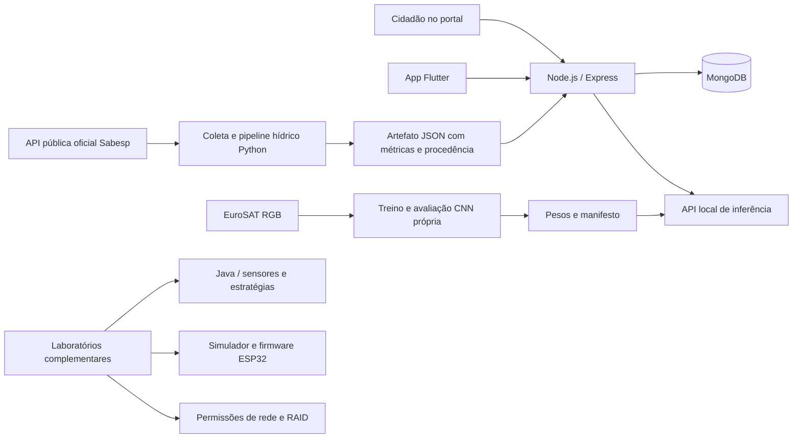

# Território Vivo — Engenharia de Software

## Problema e proposta de valor

Gestores e comunidades precisam combinar observações dispersas sobre infraestrutura e recursos hídricos. Uma ocorrência sem contexto dificulta o planejamento; uma previsão sem evidências pode produzir decisões inadequadas. O Território Vivo reúne registros de infraestrutura e dados hídricos oficiais em uma plataforma local, com alertas auditáveis e revisão humana.

Usuários: cidadão que registra problemas; analista que acompanha padrões e qualidade dos dados; gestor responsável por interpretar evidências. O protótipo não inclui autenticação de gestores nem alteração pública de prioridade/status: cadastrar e consultar são as operações expostas de CitizenTech. Integração com serviços públicos é uma evolução, não uma capacidade entregue.

## Escopo e critérios de aceite

| ID | História | Critério de aceite |
|---|---|---|
| RF01 | Como cidadão, quero registrar um problema urbano | Categoria válida, região e descrição dentro dos limites; erro claro; sucesso devolve protocolo; MongoDB persiste o registro |
| RF02 | Como cidadão, quero consultar ocorrências | Listagem paginada; filtros validados; conteúdo tratado como texto; dados pessoais não solicitados |
| RF03 | Como analista, quero acompanhar o Cantareira | Série, fonte oficial, período observado, data de atualização e unidade visíveis; falta de dados não cria medições fictícias |
| RF04 | Como analista, quero avaliar previsões | Comparação com baseline e erro fora da amostra; ordem temporal; intervalo acompanhado de cobertura e limitações |
| RF05 | Como gestor, quero entender um alerta | Cada alerta inclui motivo, evidência, confiança/qualidade, limitações e necessidade de revisão humana |
| RF06 | Como usuário móvel, quero acompanhar os indicadores | Flutter consome a API, navega entre telas, mantém estado, guarda preferências e identifica cache/offline |
| RF07 | Como pesquisador, quero experimentar uma CNN própria | EuroSAT RGB, arquitetura autoral, configurações comparáveis, escolha por validação e teste final separado |
| RF08 | Como usuário, quero classificar uma imagem de paisagem | JPEG/PNG validado; limite de upload; resultado real do modelo; pontuação não calibrada e domínio de validade informados |
| RF09 | Como operador de laboratório, quero um cruzamento acessível | Fases incompatíveis nunca ficam verdes juntas; travessia e limpeza respeitam tempos definidos; teste simulado e firmware de referência |
| RF10 | Como responsável de TI, quero justificar acessos e armazenamento | Matriz SMB/NTFS, grupos, herança, negação e comparação de capacidade/tolerância RAID; backup independente |

Requisitos não funcionais: navegação por teclado, rótulos e mensagens compreensíveis; cores não são o único canal de informação; formulários com validação no servidor; limitação de tamanho e tempo de requisição; minimização de dados pessoais; erros sem detalhes internos; isolamento explícito entre demonstração e MongoDB; indisponibilidade de ML tratada como indisponibilidade.

## Arquitetura

O pipeline hídrico funciona em lote e grava um artefato versionável; a API não treina modelos durante uma requisição. A inferência CNN usa um serviço local separado. Java e Edge são laboratórios independentes: não são apresentados como sensores ou semáforos reais conectados ao portal.

MongoDB guarda ocorrências; o banco não guarda dados de cidadãos, imagens de satélite submetidas ou credenciais. Um modo de demonstração permite conhecer as telas, com identificação explícita e armazenamento separado; ele não substitui a execução com MongoDB.

## Dados e interfaces

Ocorrência: identificador, protocolo, categoria, região agregada, descrição, status e data. Categorias: buraco, iluminação, resíduos e acessibilidade. Não há campos de nome, contato ou residência. Descrições livres podem conter dados pessoais acidentais; a interface orienta não informá-los. Publicação real requer moderação, política de retenção, autenticação administrativa e processo de atendimento.

Água: origem e checksum das respostas oficiais, CSV tratado, datas e volume útil percentual; atributos preditivos calculados somente com informações disponíveis na data de emissão. O alvo e a unidade constam do relatório de dados hídricos. Intervalos empíricos não garantem cobertura em mudanças de regime.

CNN: manifesto registra dataset, hashes, classes, configurações, partição e métricas; pesos são carregados de arquivo local conhecido. Imagens de entrada são processadas sem persistência pela aplicação.

## Decisões de projeto

1. **Java para POO:** escolha do projeto, pois o PDF não fixa linguagem; permite demonstrar interface e classes abstratas de maneira explícita.
2. **Flutter com HTTP e estado observável:** dependências pequenas e injeção de cliente para teste; preferências persistidas e cache agregado sem registros pessoais.
3. **CNN em PyTorch:** convoluções escritas no projeto, sem transferência de aprendizado. Quatro experimentos permitem variar profundidade, largura e taxa de aprendizado, uma mudança por comparação de referência.
4. **Revisão humana:** nenhum endpoint executa racionamento, priorização compulsória ou intervenção urbana.
5. **Atualização hídrica explícita:** scripts produzem dados atualizados; o protótipo não promete coleta contínua sem execução ou agendamento externo.

## Indicadores sociais propostos

| Indicador | Como medir | Limite da evidência atual |
|---|---|---|
| Tempo entre registro e triagem | Mediana entre createdAt e atendimento em implantação futura | Atendimento ainda não integrado; benefício não medido |
| Cobertura territorial | Regiões com acesso e registros / regiões atendidas | Registro digital sofre viés de acesso; não mede incidência real |
| Alertas úteis e falsos alarmes | Revisões humanas com desfecho observado | Exige acompanhamento de operação; erro de volume não prova utilidade social |
| Antecedência de escassez | Dias entre alerta validado e evento oficialmente definido | Requer definição de evento e validação prospectiva |
| Acessibilidade da travessia | Espera e tempo de passagem em cenários simulados | Simulação não comprova segurança de tráfego real |

Não são alegadas economia de água, redução de acidentes ou melhoria de atendimento observadas.

## Riscos e mitigação

- **Vazamento temporal:** separar períodos e purgar janelas que cruzem fronteiras; comparar com persistência.
- **Dados antigos ou fonte indisponível:** exibir datas e suspender uso operacional; preservar origem do cache.
- **Viés territorial:** dados do Cantareira não representam individualmente todos os municípios; EuroSAT não representa a RMSP.
- **Exclusão digital:** interface simples e acessível; canais presenciais/telefônicos precisam ser mantidos em implantação.
- **Exposição de dados livres:** orientar minimização, limitar campos, não solicitar identidade; implantação pública exige moderação e retenção.
- **Controle físico inseguro:** validar firmware na maquete, conhecer pinos e atuadores, manter intertravamento e procedimento de retorno; não aplicar em vias públicas.
- **Divergência da avaliação:** confrontar cada módulo com o enunciado completo no portal.

## Plano de demonstração e rastreabilidade

1. Iniciar MongoDB e portal; registrar uma ocorrência válida; consultar pelo protocolo/lista e mostrar rejeição de dados inválidos.
2. Mostrar a série oficial, datas, modelo escolhido, baseline e desempenho em teste; explicar um alerta e seus limites.
3. Abrir o Flutter, carregar a mesma API, mudar preferência, registrar ocorrência e demonstrar identificação de cache/offline.
4. Exibir experimentos da CNN e classificar uma imagem; explicar softmax e ausência de validação brasileira.
5. Executar Java e testes; apontar abstração, interface, encapsulamento e polimorfismo no código.
6. Executar simulação do cruzamento e comparação de políticas; demonstrar firmware apenas em maquete compatível.
7. Defender o relatório SMB/NTFS e cálculos RAID com o cenário do professor.

O estado real das verificações e pendências fica em `docs/VALIDACAO.md` e `docs/ENTREGA.md`; evidências não executadas não devem ser apresentadas como resultados.
