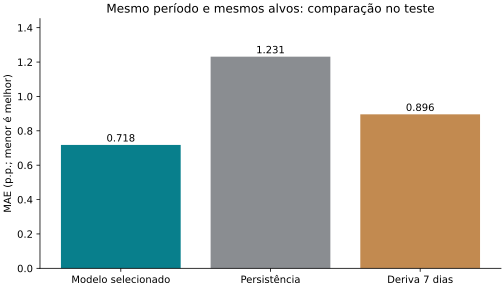
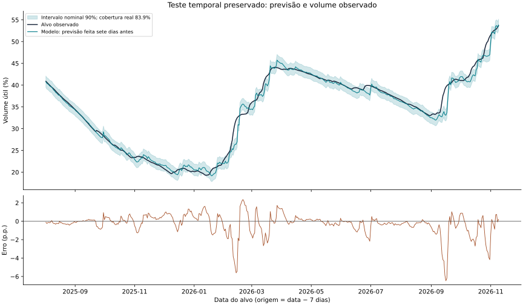

# Território Vivo — dados hídricos e modelo de previsão

O produto monitora a segurança hídrica na Região Metropolitana de São Paulo a partir de dados oficiais, com previsão quantitativa para o **Sistema Cantareira**. O recorte está limitado ao sistema agregado: não há evidência para inferir risco por residência ou bairro, nem qualidade ou potabilidade da água.

## Dados reais, origem e atualização

Foram coletadas **3.235 observações diárias reais, de 01/01/2018 a 09/11/2026**, sem lacunas nas datas e sem campos ausentes nas seis variáveis preservadas. Não foram usados dados sintéticos para treinar ou avaliar o modelo.

A origem é o [Portal dos Mananciais da SABESP](https://mananciais.sabesp.com.br/), pela API pública utilizada no próprio portal. O ID do Cantareira é 64. Os endpoints usados foram:

- `GET /api/v4/dados/ultima-data`: última data publicada pela fonte;
- `GET /api/v4/parametros`: nomes e unidades dos parâmetros oficiais;
- `GET /api/v4/sistemas/64/dados/diario/{inicio}/{fim}`: observações diárias, em lotes anuais;
- `GET /api/v4/sistemas/dados/resumo-diario/{data}`: situação atual dos sistemas produtores da RMSP.

As URLs completas, os instantes UTC da coleta, o HTTP status, os tamanhos e os hashes SHA-256 estão em `modules/water/data/manifest.json`. Cada resposta exata fica em `data/raw/<sha256>.json`, permitindo verificar e reproduzir a transformação sem rede. O CSV normalizado possui hash próprio registrado em `data/quality.json`.

Não foi localizada licença específica de reutilização no portal: `license.identifier` é `not-specified-by-source`. Acesso público não é afirmação de licença aberta. Mantêm-se atribuição e proveniência; confirmar termos para redistribuição comercial. O dataset de mananciais não contém dados pessoais.

Atualização é explícita e limitada ao corte informado pelo usuário. O pipeline rejeita datas futuras em relação ao corte, valores não finitos, sistema incorreto, duplicações e divergência entre a série e o resumo atual. Ausências não são preenchidas com zero. Se uma janela tiver dias ou variáveis ausentes, ela não participa do modelo. Falha de coleta ou treino publica `dataMode: unavailable` e não fabrica medições ou previsões. `--offline` reproduz o snapshot entregue com checagem de integridade e registra esse modo.

## Problema, variáveis e modelos

O alvo supervisionado é a variação de volume útil em sete dias, em pontos percentuais: `ΔV = V(t+7) − V(t)`. A previsão final é `V(t) + ΔV previsto`. O horizonte é fixo em sete dias; não se interpola uma curva diária prevista entre a origem e o alvo.

As 13 entradas só usam informação disponível até a origem t: volume atual e defasagens 1/7/14 dias; variações 1/7/14 dias; chuva acumulada de 7/14 dias; afluência e captação médias de sete dias; seno/cosseno do dia do ano. Os campos originais são volume útil (% e hm³), chuva (mm), afluência, captação e descarga a jusante (m³/s); descarga e volume hm³ ficam preservados para contexto, sem entrar no vetor de features atual.

Foram comparados quatro Ridge (`alpha = 0,1; 1; 10; 100`) e duas Random Forest (180 árvores; profundidade/folha 6/10 e 12/5; semente 42). A [regressão Ridge](https://scikit-learn.org/1.6/modules/generated/sklearn.linear_model.Ridge.html) usa penalização L2; padronização e parâmetros são ajustados apenas no treino. O modelo com menor MAE na validação foi **Ridge alpha 10**. O modelo congelado, escalas, médias e coeficientes estão em `artifacts/model.json`, em formato inspecionável sem pickle.

## Separação temporal sem vazamento

A divisão das observações é cronológica: 60% treino, 15% validação, 10% calibração e 15% teste. A abordagem respeita a direção do tempo e separa explicitamente os conjuntos, princípio também discutido na documentação oficial de [validação temporal do scikit-learn](https://scikit-learn.org/1.6/modules/generated/sklearn.model_selection.TimeSeriesSplit.html). O código usa a própria divisão purgada, e não `TimeSeriesSplit`.

Cada janela completa precisa caber em uma única partição: histórico desde t−14 até t, e alvo t+7. Portanto não há nenhum dia bruto compartilhado entre as janelas de partições adjacentes. São excluídas 21 origens próximas a cada fronteira. O teste unitário verifica essa desigualdade e que modificar o futuro não altera as features da origem.

| Partição | Primeiro dia de entrada | Último alvo | Amostras úteis |
|---|---|---|---:|
| Treino | 01/01/2018 | 25/04/2023 | 1.920 |
| Validação | 26/04/2023 | 22/08/2024 | 464 |
| Calibração | 23/08/2024 | 11/07/2025 | 302 |
| Teste | 12/07/2025 | 09/11/2026 | 465 |

Somente a validação escolhe modelo e hiperparâmetros. O treino fica congelado após a seleção; não há reajuste usando calibração ou teste. O período de teste tem origens de 26/07/2025 a 02/11/2026. A coleta de dados atuais não significa que o treino inclui o teste: o artefato informa `trainedThrough: 2023-04-25`.

## Resultados observados no teste

Os três métodos usam exatamente as mesmas 465 origens e alvos reais, horizonte de sete dias e unidade de pontos percentuais de volume útil.

| Método | MAE (p.p.) | RMSE (p.p.) |
|---|---:|---:|
| Ridge selecionado | 0,717844 | 1,175562 |
| Persistência: repetir V(t) | 1,231190 | 1,710886 |
| Deriva: prolongar tendência dos últimos sete dias | 0,895677 | 1,438106 |

O Ridge reduziu o MAE em aproximadamente **41,7% em relação à persistência** neste período. Essa comparação não demonstra superioridade universal e não justifica decisão automatizada sobre abastecimento. O viés médio do modelo no teste foi −0,285522 p.p., indicando subestimação média no período.

As previsões individuais, alvos e intervalos estão em `artifacts/test_predictions.csv`. `evaluate.py` recalcula MAE, RMSE e cobertura independentemente do treino e exige correspondência com `evaluation.json`.

## Incerteza, validade e decisões humanas

O intervalo nominal de 90% foi calibrado com o quantil superior de resíduos absolutos em **44 origens de calibração espaçadas por sete dias**, com raio de **1,319009 p.p.** e largura de **2,638018 p.p.**. A cobertura efetiva no teste foi **83,87%**, abaixo da nominal. Nas 67 origens de teste espaçadas por sete dias foi **83,58%**. O protótipo exibe alerta explícito dessa subcobertura; não recalibra usando o teste para melhorar artificialmente o relatório.

Dependência temporal, mudanças climáticas e alterações operacionais impedem garantia de cobertura futura. `confidence` dos alertas é `null`; a cobertura histórica não é uma probabilidade individual de acerto. A previsão usa chuva observada, não chuva futura, e não representa um balanço hidrológico físico completo.

No snapshot de 09/11/2026, o volume real foi **53,62439%**. A estimativa acadêmica para 16/11/2026 foi **55,17871%**, com intervalo nominal **[53,85970%; 56,49772%]**. Ela só é considerada atual no protótipo até dois dias após a observação; a idade deve ser recalculada pela aplicação usando a data local de São Paulo. Esses valores são registros do snapshot, não promessas de comportamento futuro.

A [Resolução Conjunta ANA/DAEE 925/2017, art. 4º](https://www.gov.br/ana/pt-br/legislacao/resolucoes/resolucoes-regulatorias/2017/925) fornece limiares de referência: Normal ≥60%; Atenção ≥40% e <60%; Alerta ≥30% e <40%; Restrição ≥20% e <30%; Especial <20%. **A classificação diária calculada no protótipo não é o enquadramento operacional mensal**, definido pelos órgãos competentes segundo o art. 6º. O usuário deve consultar atos vigentes e comunicados oficiais antes de qualquer decisão.

Todos os alertas incluem justificativa, limitações e `requiresHumanReview: true`. Não há comando automático de captação, restrição, compra ou distribuição de água. Um responsável técnico deve conferir atualização, cobertura, limites do recorte e fonte oficial antes de usar a análise em uma decisão de alto impacto.

## Reproduzir

Os comandos completos estão em `modules/water/README.md`. Sequência: instalar dependências isoladas; `update.py --as-of 2026-11-09 --offline`; `train.py --as-of 2026-11-09`; `evaluate.py`; `analyze.py`; executar `test_water.py`. A atualização online usa o mesmo comando sem `--offline`. O notebook `modules/water/analise.ipynb` apresenta dados, exploração, separação temporal, modelo e limites.

Verificações executadas: integridade dos caches e CSV; rejeição de NaN/futuro/duplicação; detecção de cache adulterado; falha transparente sem previsão; janelas ausentes sem interpolação; isolamento temporal; limites das faixas; recomputação independente das métricas e cobertura; reprodução da previsão pelo modelo JSON exportado.
