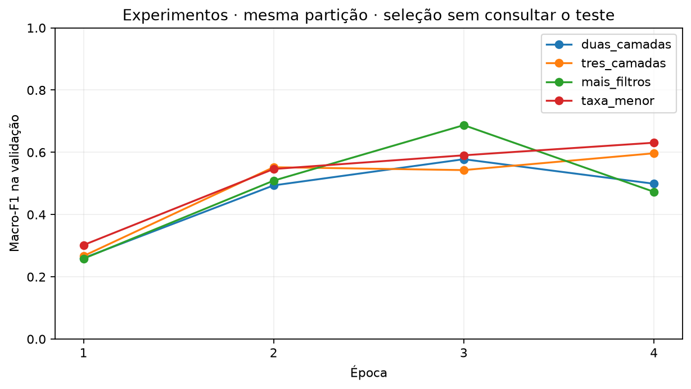
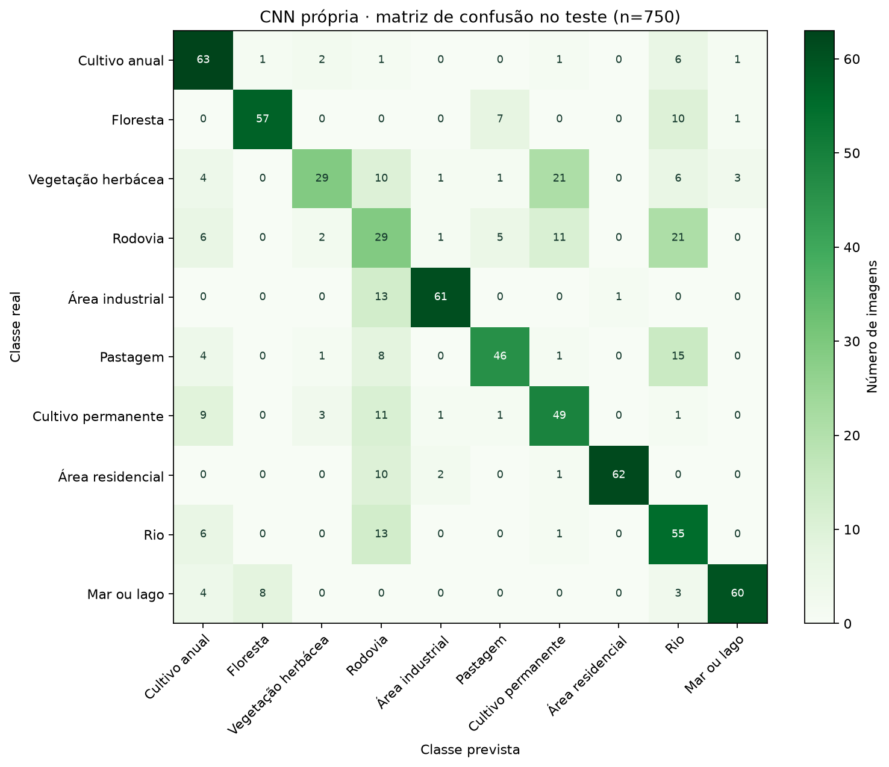

# Resultado executado da CNN

Treinamento UTC: 2026-11-10T00:32:06.883186+00:00. Semente: 42. PyTorch 2.15.0+cpu.

Dataset EuroSAT RGB; 5000 imagens selecionadas, dez classes. Treino: 3500, validação: 750, teste: 750. Teste balanceado: sim. Arquivos não selecionados não participam do experimento. Divisão estratificada por arquivo, sem separação geográfica; limitações estão abaixo.

## Comparação na validação

| Configuração | Filtros | Taxa | Parâmetros | Melhor macro-F1 validação |
|---|---|---|---|---|
| duas_camadas | [16, 32] | 0.001 | 14090 | 0.5778 |
| tres_camadas | [16, 32, 64] | 0.001 | 40906 | 0.5969 |
| mais_filtros | [24, 48, 96] | 0.001 | 78282 | 0.6873 |
| taxa_menor | [16, 32, 64] | 0.0003 | 40906 | 0.6309 |

Vencedor selecionado somente pela validação: **mais_filtros**. A comparação de profundidade é duas_camadas vs tres_camadas; largura é tres_camadas vs mais_filtros; taxa é tres_camadas vs taxa_menor. 4 épocas por configuração não demonstram convergência. Oscilações indicam sensibilidade à otimização e possível sobreajuste; não é um estudo exaustivo.

## Teste final do vencedor

- Acurácia: **68.1333%**.
- Macro-F1: **0.6892**.
- Baseline da classe majoritária: **10%**.
- Amostras: **750**.

| Classe | Precisão | Recall | F1 | Suporte |
|---|---|---|---|---|
| Cultivo anual | 0.6562 | 0.8400 | 0.7368 | 75 |
| Floresta | 0.8636 | 0.7600 | 0.8085 | 75 |
| Vegetação herbácea | 0.7838 | 0.3867 | 0.5179 | 75 |
| Rodovia | 0.3053 | 0.3867 | 0.3412 | 75 |
| Área industrial | 0.9242 | 0.8133 | 0.8652 | 75 |
| Pastagem | 0.7667 | 0.6133 | 0.6815 | 75 |
| Cultivo permanente | 0.5765 | 0.6533 | 0.6125 | 75 |
| Área residencial | 0.9841 | 0.8267 | 0.8986 | 75 |
| Rio | 0.4701 | 0.7333 | 0.5729 | 75 |
| Mar ou lago | 0.9231 | 0.8000 | 0.8571 | 75 |

As métricas são classificatórias. Não medem qualidade da água, capacidade de prever crise hídrica nem benefício social em operação.

## Limitações

- EuroSAT contém paisagens europeias; não houve validação geográfica no Brasil.
- Separação aleatória estratificada por arquivo; proximidade espacial pode inflar as métricas.
- Somente RGB, imagens redimensionadas para 64×64; não mede potabilidade ou disponibilidade hídrica.
- Pontuação softmax não é probabilidade calibrada de acerto; fotos comuns e imagens fora do domínio podem enganar a rede.
- Resultado acadêmico experimental; não decide intervenções urbanas ou ambientais.

Não há garantia de reprodutibilidade bit a bit em outras versões de PyTorch, CPU ou plataforma. O manifesto preserva versões, hashes, semente e lista dos arquivos da partição para auditoria. Comparar com o artigo original exigiria o protocolo completo; a precisão publicada pelos autores não é atribuída a este modelo.

Fonte: [EuroSAT — autores e licença](https://github.com/phelber/EuroSAT). Figuras produzidas por `report.py` a partir de `manifest.json`, sem métricas estimadas manualmente.
